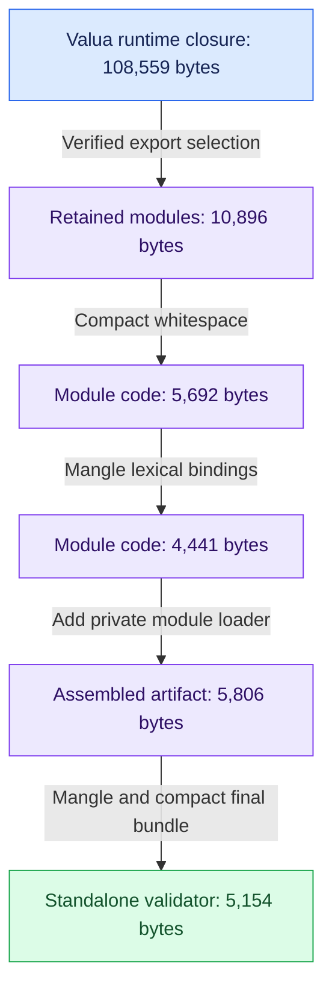

# Quaver

Quaver provides independent Lua tree-shaking, minification, and optimization passes, with a strict Ballad adapter for building smaller projects.

Add Quaver from the Moonstone registry:

```sh
moon add moonstone/quaver
moon exec -- lua -e 'print((require("quaver.minifier").minify("return 42")))'
```

Expected output: `return 42`. `moon add` synchronizes your project automatically.
For a fresh project, run `moon init . --name my-app --kind script --interpreter lua@5.4` first.

To use the Ballad adapter, add the build tool too:

```sh
moon add --tool moonstone/ballad
moon exec -- ballad play partiture.lua
```

Follow the [complete Ballad + Quaver guide](https://ballad.moonstone.sh/docs/quaver) to write the recipe.

## What gets smaller

This measured Valua consumer uses `pipe`, `string`, `length`, `non_empty`, and
`safe_parse`. Quaver verifies the selected exports, keeps their dependencies,
and then shortens the retained code:



These are source bytes for this fixture, not a general compression ratio.
The final artifact includes the loader; its last pass saves 652 bytes.
[Inspect the code and measured build steps](https://ballad.moonstone.sh/build-lab).

The core APIs are `require('quaver.tree_shaker').shake`, `require('quaver.minifier').minify`, and `require('quaver.optimizer').optimize`. Each can be imported independently. `require('quaver.build').build` composes them. `require('quaver.ballad')` exposes the Ballad optimization transform.

Start with the maintained Valua example in [the repository README](README.md). Its Strict profile is checked against initializer effects and consumer reads, then emits `validate.lua`, `quaver-report.txt`, and `quaver-contract.lua`. Conservative mode preserves a complete source inventory. Explicit runtime boundaries preserve dynamic code. [Regional composition](docs/REGIONS.md) optimizes separately owned static artifacts beside a preserved dynamic host. See [the contract documentation](docs/CONTRACTS.md). Optional Moonstone flavor specialization uses an AST and the canonical variant selector; see the flavor contract in the repository docs.

Ballad creates the versioned source package and descriptor in `dist/registry/quaver/`. Each GitHub `v*` release includes those files as release assets. The workflow submits the package to the Moonstone registry only when the repository's `MOONSTONE_TOKEN` secret is configured.
